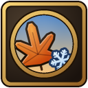
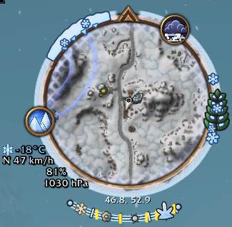
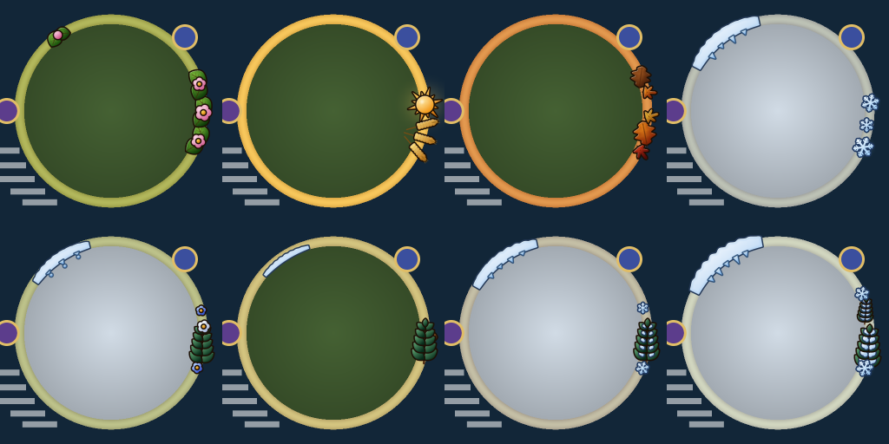
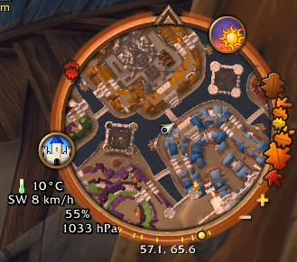

# ImmerseMe: Seasons

The turning year on your minimap, for roleplayers in **World of Warcraft: Forever**.

No new buttons: the minimap's own rim takes the colour of the season, frosts over on cold mornings,
and a thin arc under the minimap shows where you are in the year, with a mark for every festival.
Hover the rim for the date, sunrise and sunset, and what's coming up.

## What it does

- **The rim follows the seasons**: green with blossoms in spring, gold in summer, falling leaves in
  autumn, snow and icicles in winter. Hot lands get a dry season instead of snow.
- **Frost on cold mornings**, which clears by mid-morning. Dun Morogh is rimed most days; Tanaris never.
- **The season arc** under the minimap: the year from January to December, today's season, and the
  festivals (Winter Veil, Hallow's End, Midsummer and the rest). A festival that's on now glows.
- **Real calendar**: winter is in December, and everyone running the addon shares the same date.
- **A tooltip** with the date (*Year 25 after the Dark Portal*), the sun, the frost and the
  festivals ahead.

## Install

1. Download `ImmerseMe_Seasons-vX.Y.Z.zip` from the [latest release](../../releases/latest).
2. Extract it into `World of Warcraft/_forever_/Interface/AddOns/`. You should end up with an
   `AddOns/ImmerseMe_Seasons` folder.
3. Restart the game (a `/reload` is not enough the first time).

## Commands

| Command | What it does |
|---|---|
| `/ims` | The season, date, sun and festivals in chat |
| `/ims emote` | Describe the season to the people around you |
| `/ims show` / `/ims hide` | Turn the seasonal rim on or off |
| `/ims arc on\|off` | The season arc under the minimap |
| `/ims frost on\|off` | Morning frost |
| `/ims help` | Every other command |

`/seasons` works too.

## Good to know

- **English only** for now: all of the addon's text is in English, and it is only tested with an
  English game client.
- Works on its own. It pairs well with
  [ImmerseMe: Weather](https://github.com/holyc4t/ImmerseMe_Weather) (the sky) and
  [ImmerseMe: Geography](https://github.com/holyc4t/ImmerseMe_Geography) (the land), but needs
  neither. Its frost always agrees with Weather's thermometer.

## More

- [How it works](docs/how-it-works.md) and [customizing it](docs/customizing.md)
- [Contributing](CONTRIBUTING.md)

## License

[MIT](LICENSE). World of Warcraft is a trademark of Blizzard Entertainment. This is a fan project,
not affiliated with or endorsed by Blizzard.
