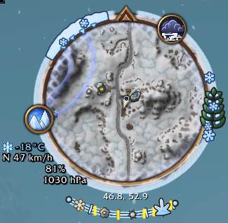
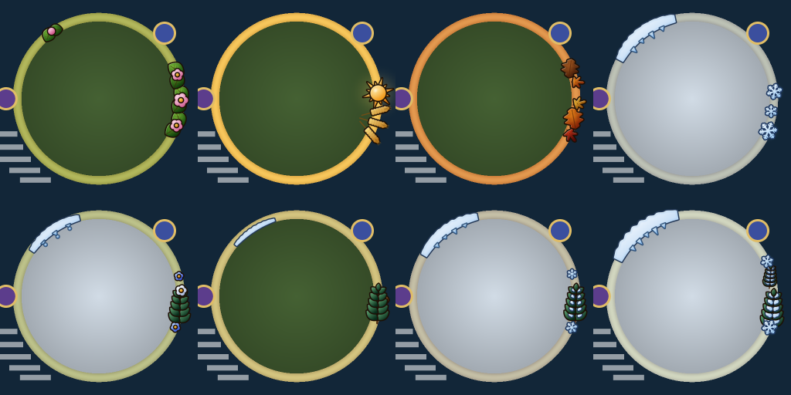

<!--
CurseForge project page for ImmerseMe: Seasons. Paste everything below the line into the
project's Description (Markdown).

  Summary (max 125 characters):
    The turning year on your minimap: the rim takes the season's colour, frosts on cold mornings and marks the festivals.
  Main category: Roleplay        License: MIT
  Avatar: docs/images/avatar.png (512x512)
  Gallery: docs/images/winter.png, seasons.png, seasonarc.png, together.png
  Source: https://github.com/holyc4t/ImmerseMe_Seasons
  Issues: https://github.com/holyc4t/ImmerseMe_Seasons/issues

Once the Weather and Geography projects exist, point their links below at their CurseForge pages.
-->
---

# ImmerseMe: Seasons

**The turning year on your minimap, for roleplayers.**

No new buttons: the minimap's own rim takes the colour of the season, frosts over on cold mornings,
and a thin arc under the minimap shows where you are in the year, with a mark for every festival.
Hover the rim for the date, sunrise and sunset, and what's coming up.

## What it does

- **The rim follows the seasons**: green with blossoms in spring, gold in summer, falling leaves in
  autumn, snow and icicles in winter. Hot lands get a dry season instead of snow.
- **Frost on cold mornings**, which clears by mid-morning. Dun Morogh is rimed most days; Tanaris never.
- **The season arc** under the minimap: the year from January to December, today's season, and the
  festivals (Winter Veil, Hallow's End, Midsummer and the rest). A festival that's on now glows.
- **Real calendar**: winter is in December, and everyone running the addon shares the same date.
- **A tooltip** with the date (*Year 25 after the Dark Portal*), the sun, the frost and the
  festivals ahead.

## Commands

- `/ims` - the season, date, sun and festivals in chat
- `/ims emote` - describe the season to the people around you
- `/ims show` / `/ims hide` - turn the seasonal rim on or off
- `/ims arc on|off` - the season arc under the minimap
- `/ims frost on|off` - morning frost
- `/ims help` - every other command

`/seasons` works too.

## Good to know

- **English only** for now: all of the addon's text is in English, and it is only tested with an
  English game client.
- After installing, restart the game once (a `/reload` doesn't load new textures).
- Part of **ImmerseMe**, a family of small roleplay addons that each work on their own. Pairs well
  with [ImmerseMe: Weather](https://github.com/holyc4t/ImmerseMe_Weather) (the sky) and
  [ImmerseMe: Geography](https://github.com/holyc4t/ImmerseMe_Geography) (the land). Its frost
  always agrees with Weather's thermometer.

Bugs and ideas: [GitHub issues](https://github.com/holyc4t/ImmerseMe_Seasons/issues).

*World of Warcraft is a trademark of Blizzard Entertainment. This is a fan project, not affiliated
with or endorsed by Blizzard.*
